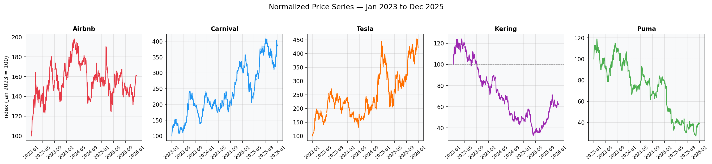
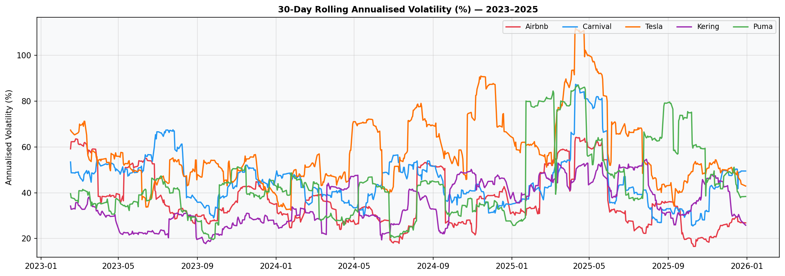
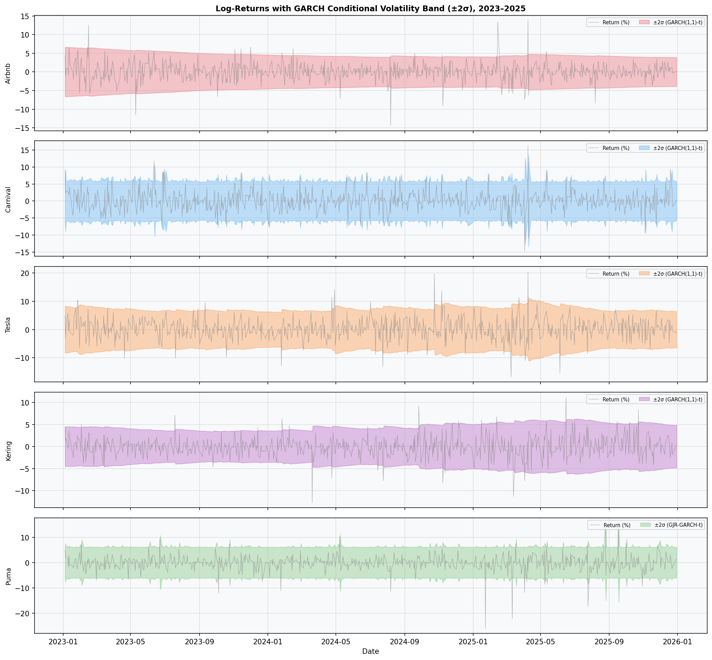
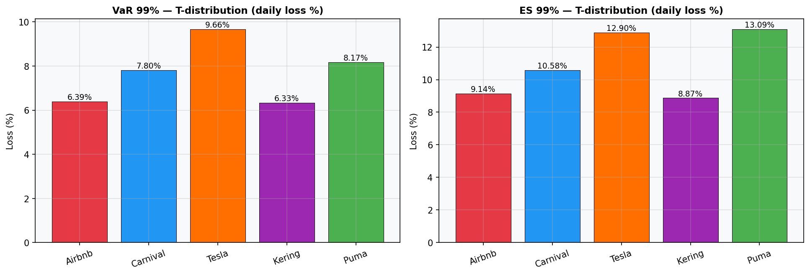
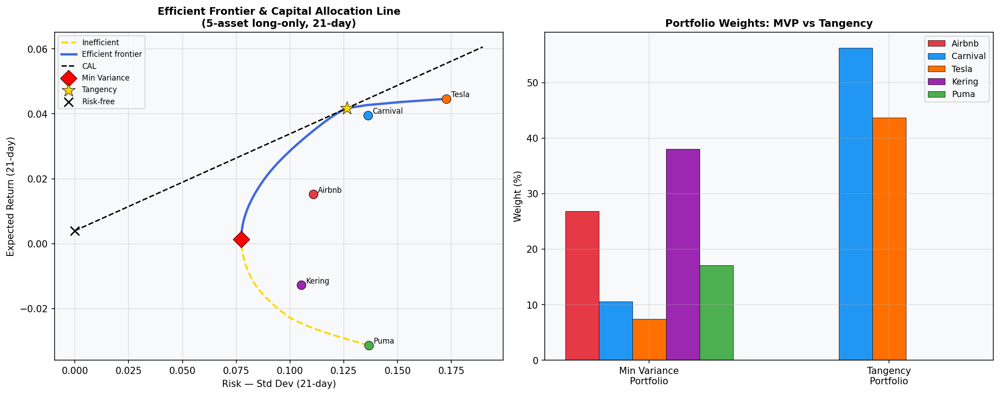
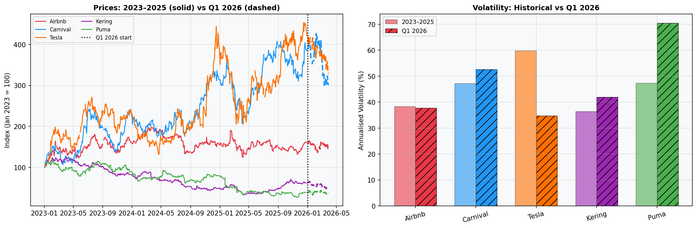

# Risk Analysis of Five Consumer Discretionary Stocks (2023–2025)

Group project for **Financial Analytics** (IE University, BDBA, 4th year). We analyse five stocks from the same sector but with very different business models, measure how risky each one is, test whether combining them reduces risk, and check how the models behaved on data they had never seen (Q1 2026).

| Ticker | Company | Business model |
|---|---|---|
| ABNB | Airbnb | Asset-light travel platform |
| CCL | Carnival | Asset-heavy cruise operator, high debt |
| TSLA | Tesla | EV / energy, growth-stock valuation |
| KER.PA | Kering | European luxury (Gucci, Saint Laurent) |
| PUM.DE | Puma | European sportswear |

**Data:** daily adjusted prices from Yahoo Finance (`yfinance`), 2023-01-01 to 2025-12-31, plus S&P 500 (`^GSPC`) as a market reference. Q1 2026 is used only as an out-of-sample test.

## Research questions

1. How risky is each stock on its own, and how much could it lose on a bad day?
2. Does combining them into a portfolio reduce that risk, even though they share a sector?
3. Do the risk models still hold on unseen 2026 data?

## Methodology

| Step | What we did | Tools |
|---|---|---|
| **EDA** | Normalised prices, daily log-returns, summary statistics, 30-day rolling volatility | pandas, matplotlib |
| **Distribution fitting** | Normal vs Student-t fits, Kolmogorov–Smirnov tests, estimated degrees of freedom | scipy |
| **Volatility modelling** | GARCH(1,1)-t vs GJR-GARCH(1,1,1)-t, best model per stock chosen by AIC, persistence = α + β + γ/2 | arch |
| **Risk measures** | VaR and Expected Shortfall at 95% / 99% with three methods: historical, Normal and Student-t | scipy |
| **Dynamic VaR** | AR(1)-GARCH(1,1)-t time-varying VaR for Tesla, with breach counting | arch |
| **Portfolio** | Correlation matrix, long-only efficient frontier (21-day horizon), minimum-variance and tangency portfolios | cvxpy |
| **Out-of-sample test** | Count 99% VaR breaches and compare volatility in Q1 2026 against 2023–2025 | yfinance |

## Key results

Returns are clearly **not normal**: every stock has positive excess kurtosis, and Puma is the extreme case (kurtosis 15.8, worst day −25.9%).

| Stock | Ann. vol | Best model | Persistence | t-df | VaR 99% (t) | ES 99% (t) |
|---|---|---|---|---|---|---|
| Airbnb | 38.4% | GARCH-t | 0.994 | 3.71 | 6.39% | 9.14% |
| Carnival | 47.2% | GARCH-t | 0.144 | 4.53 | 7.80% | 10.58% |
| Tesla | 59.9% | GARCH-t | 0.981 | 4.89 | 9.66% | 12.90% |
| Kering | 36.5% | GARCH-t | 0.999 | 3.88 | 6.33% | 8.87% |
| Puma | 47.3% | GJR-GARCH-t | 0.139 | 2.75 | 8.17% | 13.09% |

*Daily VaR / ES expressed as a loss percentage. Full tables are in [`figures/master_comparison.csv`](figures/master_comparison.csv) and [`figures/summary_statistics.csv`](figures/summary_statistics.csv).*

- **Tesla is the riskiest by volatility and VaR**, with the highest annualised volatility of the group.
- **VaR and ES rank Puma differently.** Puma's VaR is below Tesla's, but its ES is the highest of the five. Its tail is so heavy (t-df = 2.75) that the losses beyond the VaR threshold are the worst in the group, which is why ES is the better measure here.
- **Volatility persistence differs a lot.** Kering, Airbnb and Tesla have very persistent volatility (shocks fade slowly); Carnival and Puma have shocks that disappear quickly.
- **Diversification works inside a single sector.** The minimum-variance portfolio has lower risk than any of the five individual stocks.

## Selected figures

| | |
|---|---|
|  |  |
|  |  |
|  |  |

All 12 figures are in [`figures/`](figures/).

## Repository structure

```
.
├── analysis.ipynb                  # Notebook version of the analysis (written for Google Colab)
├── run_analysis.py                 # Same analysis as a script: prints results, saves figures/ and CSVs
├── figures/                        # Output plots (01–12) and result tables (CSV)
└── requirements.txt
```

## How to run

Requires Python 3.10+ and an internet connection (data is downloaded from Yahoo Finance).

```bash
git clone https://github.com/<your-username>/<repo-name>.git
cd <repo-name>

python -m venv .venv
source .venv/bin/activate        # Windows: .venv\Scripts\activate
pip install -r requirements.txt

python run_analysis.py
```

The script prints every result to the terminal and regenerates the files in `figures/`. To use the notebook instead, open `analysis.ipynb` in Jupyter or upload it to Google Colab and run the cells from top to bottom.

> Yahoo Finance data can be revised over time, so a fresh run may differ slightly from the numbers above.

## Team

Mayer (Airbnb) · Louis (Carnival) · Oscar (Tesla) · Juanse (Kering) · Tamer (Puma)

## Limitations

- Three years of daily data and five stocks only; results describe this sample, not the sector in general.
- The efficient frontier uses historical mean returns, which are noisy estimates, and it is long-only.
- Kering and Puma trade in EUR and the others in USD; returns are computed in local currency without FX adjustment.
- The Q1 2026 backtest covers about 60 trading days, so a few breaches can change the conclusion.
